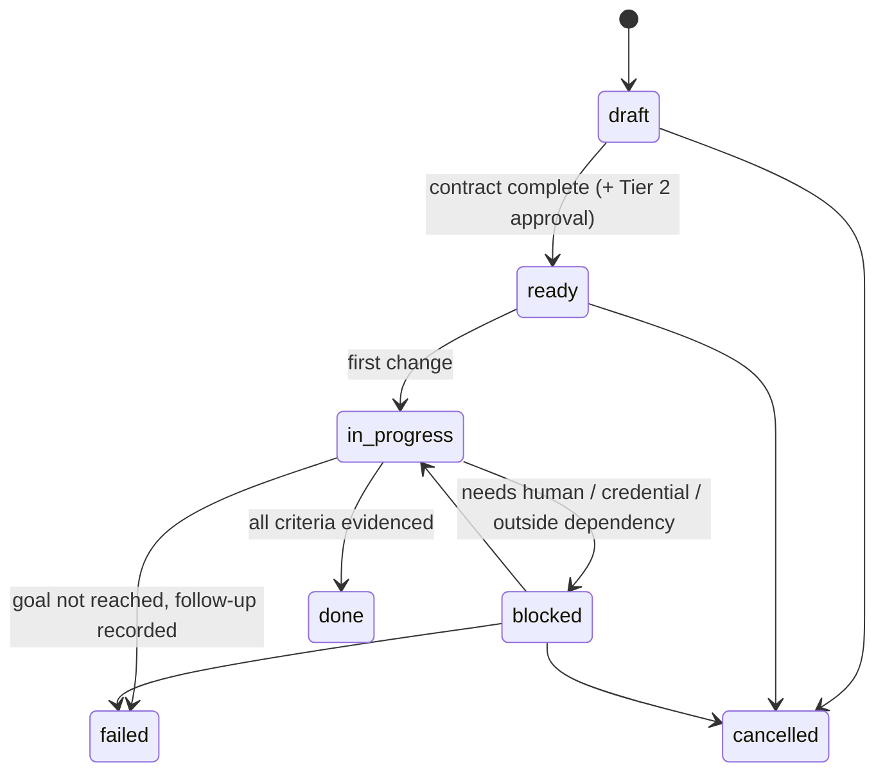

# Task lifecycle

## Identity

Task ID: `TASK-YYYYMMDD-NN-slug`. Date created, a per-day sequence number, a kebab-case slug. The folder name and the `id` in the front matter are the same string. Always cite tasks by the full ID including the slug.

`agentproof new-task` computes `NN` from the task files that exist anywhere under `tasks/`, so it does not hand out duplicates.

## Layout

```text
tasks/
  README.md                  generated ledger, never edited by hand
  TASK-20260914-03-pulse-flaky-reminder-test/
    task.md                  the contract (front matter + sections)
    evidence/
      evidence.md            what ran, what was observed, the criteria table
      journal.md             written by `agentproof run` (optional)
    artifacts/               small diffs, configs, reports (optional)
    data/                    raw data pulled for the task (gitignored)
```

## Statuses



(The diagram uses `in_progress` because Mermaid does not allow dashes in state names. The status value is `in-progress`.)

What each status requires, checked by `agentproof validate`:

| Status | Required |
|---|---|
| `draft` | front matter |
| `ready` | all contract sections; for Tier 2, a filled **Approvals** section |
| `in-progress` | as `ready`, plus a filled **Handoff** |
| `blocked` | as `in-progress`; Handoff names the blocker and the smallest decision needed |
| `done` | `evidence/evidence.md` with all its sections |
| `failed` | as `done`; evidence names the follow-up task |
| `cancelled` | a reason in Handoff or Goal |

**Blocked means blocked.** Only a missing human decision, credential, approval or outside dependency blocks a task. A failing test or a flaky host is work, not a blocker.

## The ledger

`agentproof ledger` writes `tasks/README.md`: one row per task, newest first, with ID, title, product, tier, status and last update. CI runs `agentproof ledger --check`, which fails when the file is out of date.

## Stale work

`agentproof validate` warns about tasks that are `in-progress` or `blocked` and have not been updated for 14 days (`--stale-days` to change it). For each one: finish it, record why it is blocked, or cancel it.

## History is not rewritten

A closed task is what was observed on its date. If it turns out to be wrong, open a follow-up task and correct the knowledge doc. Don't edit the old evidence. Deleting old task folders is the human's call, never the agent's.

## One task, one goal

- Two goals with different risk (deploy + DNS change) are two tasks.
- Work found along the way that is outside *Scope → Touch* is a new task. Link the two with full IDs in *Related tasks*.
